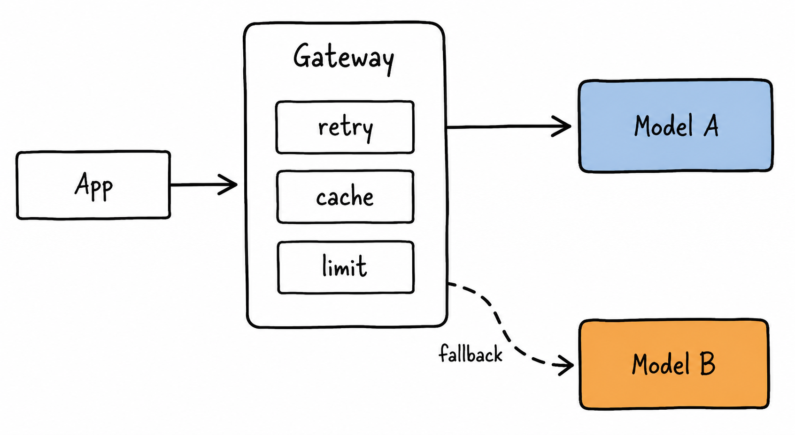
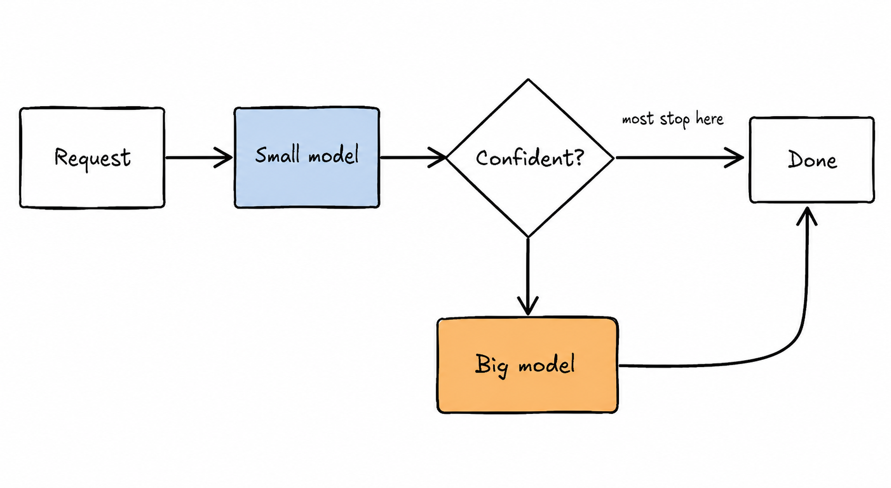
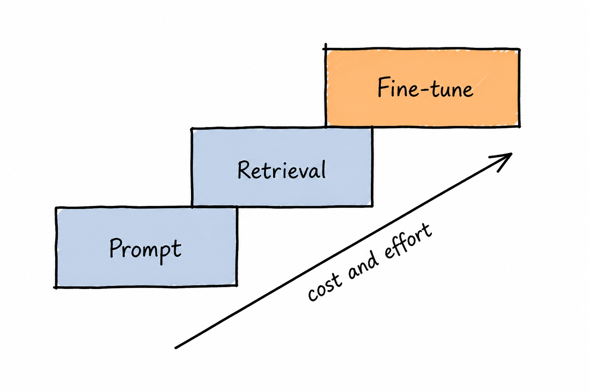

# 06 · Deployment & AI Infra

> Shipping the model is the easy part. Knowing your cost per request, p95 latency, and failure behaviour under load is the job.

## Why This Matters

LLM workloads break the assumptions ordinary backend engineering is built on: responses take seconds not milliseconds, they stream, they cost real money per call, throughput is bounded by GPU memory rather than CPU, and your most important dependency is a third-party API with rate limits and its own incidents. This module covers serving models, wrapping them in an API layer that degrades gracefully, and driving down cost and latency without silently trading away quality.

---

## Key Subtopics

*One request path, one ingestion path, joined only at the index — with two of the thirteen boxes actually calling a model.*

### 6.1 Serving and inference optimization

Serving throughput is a memory problem. **Continuous batching** merges incoming requests into the running batch instead of waiting for a batch to fill, which is the single largest throughput win. **PagedAttention** stores the KV cache in non-contiguous blocks, eliminating the fragmentation that otherwise wastes most of your GPU memory. On top of that: **quantization** (FP8/INT8/INT4) shrinks weights and KV cache to fit bigger models or longer contexts on the same card, at a measurable but often acceptable quality cost; **speculative decoding** uses a small draft model to propose tokens a large model verifies in parallel, cutting latency without changing output distribution; **prefix caching** reuses KV state across requests sharing a prompt prefix. Know the two throughput regimes — TTFT is prefill-bound (compute), inter-token latency is decode-bound (memory bandwidth) — because they're optimized differently.

- [Efficient Memory Management for LLM Serving with PagedAttention](https://arxiv.org/abs/2309.06180) — the vLLM paper
- [vLLM docs](https://docs.vllm.ai/) · [SGLang](https://docs.sglang.ai/) — the two dominant OSS serving engines
- [Fast Inference from Transformers via Speculative Decoding](https://arxiv.org/abs/2211.17192) · [FlashAttention](https://arxiv.org/abs/2205.14135)

### 6.2 API-layer architecture: gateways, streaming, fallbacks

Never let application code call a provider SDK directly. Put an **AI gateway** in between — your own thin service or an off-the-shelf one — and centralize: provider routing and fallback, retries with exponential backoff **and jitter**, timeouts, per-tenant rate limiting and budgets, key management, structured logging, and caching. Stream responses over SSE so TTFT is what the user experiences, and make sure your whole stack (load balancer, proxy, framework) supports streaming without buffering — buffering is the classic bug that silently converts a 400 ms TTFT into a 12 s wait. Add **semantic caching** (embed the request, serve a cached response above a similarity threshold) only where stale-but-similar answers are acceptable; exact-match caching is safer and often enough.

- [LiteLLM](https://docs.litellm.ai/) — 100+ providers behind one OpenAI-compatible interface, plus routing and budgets
- [Anthropic: Handling rate limits and errors](https://docs.claude.com/en/api/rate-limits)
- [Portkey](https://portkey.ai/docs) · [Kong AI Gateway](https://docs.konghq.com/gateway/latest/ai-gateway/) — managed gateway options

### 6.3 Cost and latency engineering

Treat tokens as a first-class budget line. The levers, roughly in order of return:

1. **Model tiering / cascades** — route easy requests to a small fast model, escalate only on low confidence or explicit complexity signals. Often 60–80% cost reduction with no measurable quality loss.
2. **Prompt caching** — up to ~90% off repeated input prefixes and a big TTFT cut. Requires a stable prefix; order your prompt accordingly.
3. **Output length control** — output tokens dominate both cost and latency. Cap `max_tokens`, ask for terse formats, avoid asking for restated input.
4. **Batch APIs** — asynchronous bulk processing at roughly half price when latency doesn't matter.
5. **Context discipline** — retrieve 5 good chunks, not 50 mediocre ones.

Measure p50/p95/p99, never the mean; LLM latency distributions have long tails. And measure under realistic concurrency — single-request benchmarks are marketing, not capacity planning.

- [Anthropic: Prompt caching](https://docs.claude.com/en/docs/build-with-claude/prompt-caching) · [Batch processing](https://docs.claude.com/en/docs/build-with-claude/batch-processing)
- [Anthropic: Reducing latency](https://docs.claude.com/en/docs/build-with-claude/reduce-latency)
- [LLM Inference Performance Engineering: Best Practices (Databricks)](https://www.databricks.com/blog/llm-inference-performance-engineering-best-practices)

### 6.4 Fine-tuning vs. RAG vs. prompting

The decision order is almost always: **prompt → retrieval → fine-tune**, and most teams reach for fine-tuning far too early. Fine-tuning teaches *form* — tone, output structure, domain jargon, a narrow classification boundary — it does not reliably teach *facts*, and facts change anyway (that's what retrieval is for). It's worth doing when you have ≥1,000 high-quality examples, a stable task, evals proving prompting has plateaued, and a real cost or latency motive (distilling a frontier model's behaviour into a small one you serve cheaply is the strongest case). **LoRA/QLoRA** make this affordable: train a small number of adapter parameters, serve many adapters on one base model. Budget for the hidden cost — every base-model upgrade means re-training and re-validating.

- [LoRA: Low-Rank Adaptation](https://arxiv.org/abs/2106.09685) · [QLoRA](https://arxiv.org/abs/2305.14314)
- [Axolotl](https://docs.axolotl.ai/) · [Unsloth](https://docs.unsloth.ai/) · [HF TRL](https://huggingface.co/docs/trl) — the practical fine-tuning stack
- [OpenAI: Model distillation / fine-tuning guide](https://platform.openai.com/docs/guides/fine-tuning)

### 6.5 Reliability and operations

Production concerns that are specific to this stack: **pin model versions** — auto-upgrades change behaviour and will silently break prompts, so pin, then upgrade deliberately behind your eval gate. **Multi-provider failover** for availability, with the caveat that prompts are not perfectly portable, so keep a per-provider eval run. **Quota and capacity planning** — rate limits are per-org and per-model; know your headroom before launch, and use provisioned throughput for predictable load. **Data governance** — know what each provider retains, whether it trains on your data, where it's processed, and redact PII before it leaves your perimeter. **Graceful degradation** — when the model is down or over budget, serve a cached answer, a smaller model, or an honest error; never a spinner. And for self-hosted GPUs: cold starts are measured in minutes, so keep warm pools and autoscale on queue depth rather than CPU.

- [Google SRE Workbook](https://sre.google/workbook/table-of-contents/) — SLOs and error budgets apply directly
- [Modal](https://modal.com/docs) · [Baseten](https://docs.baseten.co/) · [Together](https://docs.together.ai/) — serverless/managed GPU inference
- [Ray Serve](https://docs.ray.io/en/latest/serve/index.html) · [KServe](https://kserve.github.io/website/) — self-managed serving on Kubernetes

### 6.6 Multi-tenancy: isolation, quotas, and cost attribution

The moment more than one customer shares your AI stack, you inherit a problem ordinary multi-tenancy doesn't have: **the scarce resource is rented and hard-capped**. Provider rate limits are per-org and per-model, so one tenant's burst becomes everyone else's 429 — and unlike CPU, you can't buy your way out of it in the next five minutes. Design for that explicitly. Give every tenant a **budget and a concurrency slot**, not just a request rate: agent workloads hold a slot for minutes, so admission control matters far more than requests per second. Enforce it in the **gateway** ([§6.2](#62-api-layer-architecture-gateways-streaming-fallbacks)) with per-tenant virtual keys, never in application code where every new service re-implements it slightly differently. Separate the pools by traffic shape — interactive chat, long-running agents, and batch jobs should not draw from the same quota, or a backlog of agent runs will starve the chat box your users are staring at. Keep headroom in reserve for the interactive tier and shed load into a queue for the rest.

Two failure modes deserve naming. **Cross-tenant cache leakage**: an exact-match or semantic cache keyed on prompt text alone will happily serve tenant A's answer to tenant B — namespace every cache, retrieval index, and memory store by tenant, and enforce the filter in the query rather than asking the model to be discreet. **Unattributable spend**: if calls aren't tagged with tenant, feature, and prompt version, you cannot answer "which customer is unprofitable?" — and on usage-based pricing that question *is* the business. Tag at the gateway, aggregate daily, and alert on per-tenant anomalies; a looping agent on one account can burn an org-wide quota before anyone notices. One interaction worth knowing: prompt caching rewards a **shared prefix**, so order prompts with the common system content first and tenant-specific context after, or you'll trade your cache hit rate for your isolation story.

- [LiteLLM: virtual keys, budgets and per-key spend](https://docs.litellm.ai/docs/proxy/virtual_keys) — the reference implementation of gateway-enforced tenancy
- [Google SRE: Handling overload](https://sre.google/sre-book/handling-overload/) — graceful degradation and fair sharing under a hard ceiling
- [Anthropic: rate limits](https://docs.claude.com/en/api/rate-limits) — what the per-org ceiling actually looks like

---

## Tools & Frameworks Used in Industry

| Purpose | Tools |
|---|---|
| Inference engines | [vLLM](https://docs.vllm.ai/), [SGLang](https://docs.sglang.ai/), [TensorRT-LLM](https://nvidia.github.io/TensorRT-LLM/), [TGI](https://huggingface.co/docs/text-generation-inference), [llama.cpp](https://github.com/ggml-org/llama.cpp), [Ollama](https://ollama.com/) |
| Managed model APIs | Amazon Bedrock, Google Vertex AI, Azure AI Foundry, Anthropic/OpenAI/Google direct |
| GPU platforms | [Modal](https://modal.com/), [RunPod](https://www.runpod.io/), [Baseten](https://www.baseten.co/), [Together](https://www.together.ai/), [Fireworks](https://fireworks.ai/), [Groq](https://groq.com/) |
| Gateways & routing | [LiteLLM](https://docs.litellm.ai/), [OpenRouter](https://openrouter.ai/), [Portkey](https://portkey.ai/), [Cloudflare AI Gateway](https://developers.cloudflare.com/ai-gateway/), Kong AI Gateway |
| Fine-tuning | [Axolotl](https://docs.axolotl.ai/), [Unsloth](https://docs.unsloth.ai/), [TRL](https://huggingface.co/docs/trl), [PEFT](https://huggingface.co/docs/peft), provider fine-tuning APIs |
| Caching | Redis, [GPTCache](https://github.com/zilliztech/GPTCache), provider prompt caching |
| Load testing | [k6](https://k6.io/), [Locust](https://locust.io/), [vLLM benchmark suite](https://docs.vllm.ai/en/latest/contributing/benchmarks.html), [GuideLLM](https://github.com/neuralmagic/guidellm) |
| Orchestration | Kubernetes, [Ray Serve](https://docs.ray.io/en/latest/serve/index.html), [KServe](https://kserve.github.io/website/), Docker Compose (small deployments) |

---

## Hands-On Project: Self-Hosted Model Behind a Gateway, Load-Tested

**Deploy an open-weights model, put a real API layer in front of it, and publish the numbers.**

Requirements:
1. Serve an open-weights model (7–14B class) with **vLLM** on a rented GPU. Enable prefix caching.
2. Build a small gateway service exposing a streaming SSE endpoint, with: per-key rate limiting, request timeouts, retries with jittered backoff, exact-match caching, and **fallback to a frontier API** when the local model errors or exceeds a latency budget.
3. Log every request with the [Module 05](../05-evaluation-and-observability/README.md) attribute set: model, tokens, cost, TTFT, total latency, cache hit, fallback triggered.
4. Load test with k6 or Locust at 1, 10, and 50 concurrent users. Report TTFT and end-to-end latency at p50/p95/p99, plus tokens/sec throughput and error rate at each level.
5. Publish a cost comparison: self-hosted $/1M tokens (GPU hourly cost ÷ measured throughput) vs. the frontier API's list price, including idle time.
6. Demonstrate three optimizations with before/after numbers: quantization (e.g. FP8 or INT4), prompt caching on a shared prefix, and a model cascade routing easy requests to the small model.
7. Kill the GPU mid-test and show the fallback path serving traffic.

**Done when:** you have a README table with real latency percentiles and $/1M tokens at each concurrency level, and you can say at what request volume self-hosting actually becomes cheaper than the API.

**Stretch:** add speculative decoding and quantify the ITL improvement; then LoRA-tune the model on a narrow task and serve the adapter alongside the base model.

---

## Common Pitfalls

- **Benchmarking at concurrency 1.** Meaningless for capacity. Throughput and latency curves only appear under load.
- **Reporting mean latency.** LLM tails are brutal. p95/p99 or it didn't happen.
- **No timeouts.** A hung upstream connection holds a worker until something else falls over.
- **Retries without jitter or a circuit breaker.** You'll turn a provider blip into a self-inflicted retry storm and blow your rate limit.
- **Buffering proxies breaking streaming.** Everything works locally, TTFT is 12 s in staging. Check nginx/ALB/framework buffering settings.
- **Costing input tokens only.** Output is 3–5× the rate and reasoning tokens bill as output.
- **Cache-busting prefixes.** A timestamp or session ID at the top of the prompt makes prompt caching a no-op.
- **Not pinning model versions.** A provider's silent model update becomes an unexplained quality regression next Tuesday.
- **Fine-tuning before evals.** You'll spend weeks and have no way to know whether it helped.
- **Assuming prompts port across providers.** They don't, quite. Re-run evals per provider before you rely on failover.
- **Ignoring cold starts.** Serverless GPU + a 30 GB model = minutes to first request. Keep warm pools.
- **Sending PII to third-party APIs without checking retention and processing terms.** That's a compliance incident, not a bug.
- **A response cache shared across tenants.** Keyed on prompt text alone, it will serve one customer's answer to another. Namespace it.
- **Per-tenant limits enforced in application code.** Every service implements them slightly differently and one of them forgets. Enforce at the gateway.

---

## Progress

- [ ] 6.1 Serving and inference optimization
- [ ] 6.2 API-layer architecture: gateways, streaming, fallbacks
- [ ] 6.3 Cost and latency engineering
- [ ] 6.4 Fine-tuning vs. RAG vs. prompting
- [ ] 6.5 Reliability and operations
- [ ] 6.6 Multi-tenancy: isolation, quotas, and cost attribution
- [ ] **Project:** self-hosted model behind a gateway, load-tested

---

[← 05 · Evaluation & Observability](../05-evaluation-and-observability/README.md) · [Back to root](../README.md) · [Next: 07 · Emerging Topics →](../07-emerging-topics/README.md)
